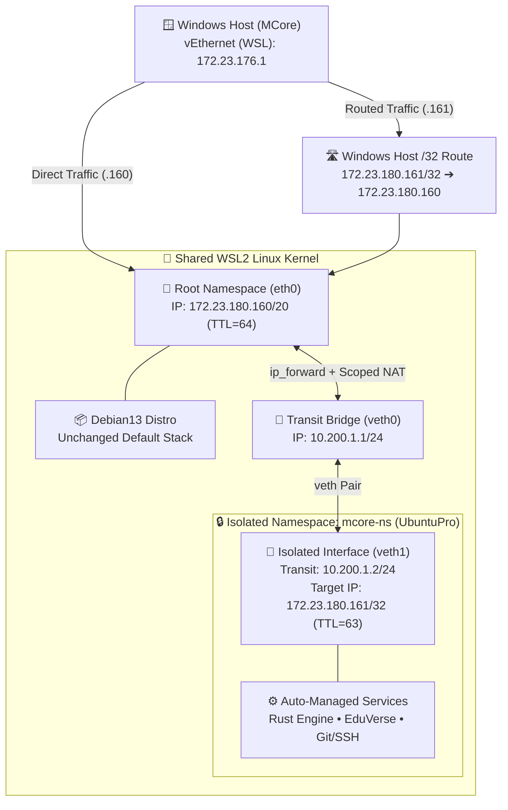
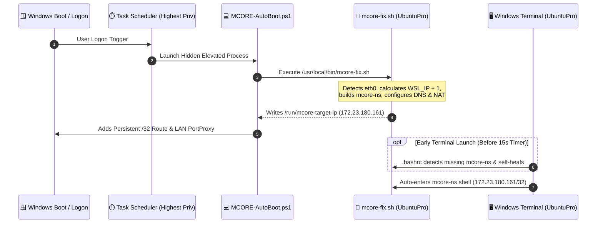

# WSL-devNet

  

  

**Enterprise-grade dual-distro WSL2 network isolation, dynamic IP offset routing (`WSL_IP + 1`), and zero-touch cold-boot recovery.**

Run multiple WSL2 Linux distributions concurrently on a single Windows host with **distinct, dedicated IP addresses**, isolated port spaces, automatic shell entry, and native LAN forwarding—without modifying the primary WSL2 distribution.

---

## System Architecture Flowchart



---

## Cold-Boot & Self-Healing Startup Flowchart



---

## Programming Languages & Core Technologies

| Layer | Language / Technology | Purpose in WSL-devNet |
| :--- | :--- | :--- |
| **Linux Orchestration** | **Bash / POSIX Shell** | Automates network namespace creation, dynamic subnet/IP arithmetic (`WSL_IP + 1`), shell auto-entry hooks, and service lifecycle management. |
| **Windows Automation** | **PowerShell (5.1 / 7+)** | Manages elevated host route injection (`route add`), LAN `netsh portproxy` forwarding, firewall rules, and Task Scheduler registration. |
| **Kernel Networking** | **Linux `iproute2` (`ip netns`, `veth`)** | Provides kernel-level network stack isolation, virtual Ethernet pairs, and explicit gateway return routing (`10.200.1.0/24`). |
| **Packet Filtering & NAT** | **Netfilter / `iptables`** | Enables stateful IPv4 forwarding and scoped `MASQUERADE` NAT (`! -d $WSL_SUBNET`) so return traffic preserves its `172.23.180.161` source identity. |
| **Documentation & Diagrams** | **Markdown & Mermaid.js** | Renders interactive architecture and sequence diagrams natively in GitHub. |

---

## Repository Structure

```text
WSL-devNet/
├── README.md                              # Overview, Mermaid flowcharts, tech stack & quick start
├── setup.sh                               # One-command Linux deployment script
├── mcore-fix.sh                           # Core namespace, dynamic +1 IP, DNS & scoped NAT builder
├── mcore-services.sh                      # Startup hook for background services inside mcore-ns
├── enable-auto-ns-shell.sh                # Configures .bashrc for automatic namespace entry on launch
├── MCORE-AutoBoot.ps1                     # Windows startup script for /32 host routing & LAN forwarding
├── Install-MCORE-Task.ps1                 # Registers silent Task Scheduler job (no UAC prompt)
└── docs/
    └── ARCHITECTURE_AND_VERIFICATION.md   # Deep-dive topology, packet flow & verification guide
```

---

## Quick Startup Deployment

### 1. Deploy on UbuntuPro (Linux Side)
```bash
git clone git@github.com:aminul-du/WSL-devNet.git
cd WSL-devNet
./setup.sh
```

### 2. Deploy on Windows (Administrator PowerShell)
```powershell
New-Item -ItemType Directory -Force -Path "C:\Scripts" | Out-Null
Copy-Item ".\MCORE-AutoBoot.ps1" "C:\Scripts\MCORE-AutoBoot.ps1" -Force
.\Install-MCORE-Task.ps1
```

---

## Detailed Documentation

See **[docs/ARCHITECTURE_AND_VERIFICATION.md](docs/ARCHITECTURE_AND_VERIFICATION.md)** for full packet-level explanations, escape-hatch commands, and cold-boot verification steps.
