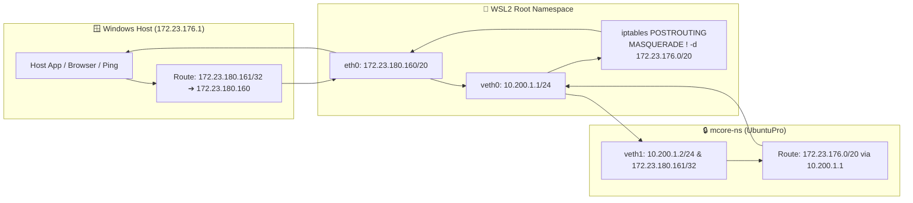

# Architecture, Startup Lifecycle & Verification Guide

Technical deep-dive for **WSL-devNet**: running **Debian13** (`172.23.180.160`) and **UbuntuPro** (`172.23.180.161`) concurrently on Windows WSL2 with complete network isolation, automatic shell entry, and zero-touch cold-boot recovery.

---

## 1. Packet Flow & NAT Isolation Diagram



### Why Scoped NAT (`! -d $WSL_SUBNET`) Is Essential
1. **Explicit Return Gateway:** Linux normally creates an on-link route for `172.23.176.0/20` when an IP in that range is assigned. Replacing it with `via 10.200.1.1 dev veth1` forces return packets through the `veth` bridge rather than failing ARP inside the isolated namespace.
2. **Source IP Preservation:** Excluding `$WSL_SUBNET` from `MASQUERADE` ensures packets returning to Windows (`172.23.176.1`) retain `172.23.180.161` as their source IP instead of being rewritten to `172.23.180.160`.

---

## 2. Confirmed Production Behavior

* **Automatic Namespace Entry:** Opening `UbuntuPro` in Windows Terminal—including right after a PC reboot—automatically enters `mcore-ns` and lands on **`172.23.180.161/32`** (`veth1`).
* **Self-Healing Early Boot:** If `UbuntuPro` is launched before the 15-second Task Scheduler delay completes, `/root/.bashrc` and `~/.bashrc` detect the missing namespace and execute `/usr/local/bin/mcore-fix.sh` automatically.
* **Transparent Developer Tooling:** `git`, `ssh`, `curl`, Rust binaries, and Node/web servers run directly on `172.23.180.161` without requiring `ip netns exec` prefixes.
* **Zero Interference with Debian13:** `Debian13` remains untouched on `172.23.180.160/20` (`TTL=64`).

---

## 3. Verification & Cold-Boot Test Commands

### Inside `UbuntuPro` (Auto-Entered `mcore-ns`)
```bash
# 1. Confirm veth1 holds 172.23.180.161/32
ip a

# 2. Check dynamic target IP file
mcore-ip

# 3. Verify external internet & DNS resolution
curl -I https://github.com

# 4. Escape hatch to root WSL2 namespace (172.23.180.160) if needed
MCORE_NO_NS=1 bash
```

### From Windows PowerShell (Cold-Boot Recovery Test)
```powershell
# 1. Shut down WSL2 VM completely (resets namespaces and dynamic IPs)
wsl --shutdown

# 2. Trigger silent background startup task
Start-ScheduledTask -TaskName "MCORE-AutoBoot"
Start-Sleep -Seconds 20

# 3. Verify both distributions respond with distinct TTLs
ping -n 2 172.23.180.160   # Debian13 (TTL=64)
ping -n 2 172.23.180.161   # UbuntuPro mcore-ns (TTL=63)
```
