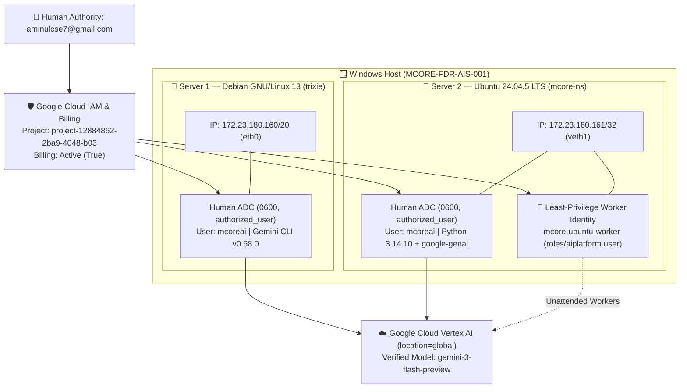

# Two-Server Vertex AI Identity & Architecture Audit Report

**Authority:** AIS / MCORE-FDR-AIS-001  
**Verified Status:** COMPLETE (Both Nodes)  
**Target Project:** `project-12884862-2ba9-4048-b03`  
**Default Endpoint Location:** `global`  

---

## 1. Verified Two-Server Architecture Diagram



---

## 2. Verified Audit Matrix

| Audit Dimension | Server 1 — Debian GNU/Linux 13 | Server 2 — Ubuntu 24.04.5 LTS | Status |
| :--- | :--- | :--- | :--- |
| **Network Isolation** | `172.23.180.160/20` (`eth0`) | `172.23.180.161/32` (`mcore-ns` / `veth1`) | **COMPLETE** |
| **Operator Account** | Non-root `mcoreai` | Non-root `mcoreai` | **COMPLETE** |
| **Authenticated Identity** | `aminulcse7@gmail.com` | `aminulcse7@gmail.com` | **COMPLETE** |
| **Host-Local ADC (`0600`)** | `/home/mcoreai/.config/gcloud/application_default_credentials.json` (`431B`) | `/home/mcoreai/.config/gcloud/application_default_credentials.json` (`407B`) | **COMPLETE** |
| **Credential Isolation** | Independent local OAuth grant (no copied files) | Independent local OAuth grant (no copied files) | **COMPLETE** |
| **GCP Project & Region** | `project-12884862-2ba9-4048-b03` (`global`) | `project-12884862-2ba9-4048-b03` (`global`) | **COMPLETE** |
| **Runtime & Live Inference** | `Gemini CLI v0.68.0` | `Python 3.14.10` + `google-genai` (`gemini-3-flash-preview`) | **COMPLETE** |
| **Worker Identity** | Interactive Human ADC | `mcore-ubuntu-worker` (`roles/aiplatform.user`, zero static JSON keys) | **COMPLETE** |

---

## 3. Core Security & Governance Rules

1. **No Cross-Host Credential Copying:** Each server generates and refreshes its own local `~/.config/gcloud/application_default_credentials.json` with strict `0600` (`-rw-------`) file permissions.
2. **Human vs. Workload Separation:** Interactive development uses human ADC (`aminulcse7@gmail.com`), while automated background services and workers on Ubuntu use the dedicated `mcore-ubuntu-worker` Service Account scoped strictly to `roles/aiplatform.user`.
3. **Zero Static JSON Keys:** Service account access uses Service Account Impersonation or Workload Identity Federation rather than storing static `.json` key files on disk.
4. **Scoped Endpoint Routing:** Newer Gemini 3 series models (`gemini-3-flash-preview`) route through `GOOGLE_CLOUD_LOCATION="global"`.

---

## 4. Read-Only Verification Commands (Secret-Safe)

Run as `mcoreai` on either server to verify live state without exposing tokens or secrets:

```bash
ip a | grep 172.23
gcloud auth list --format="table(account,status)"
gcloud config list --format="value(core.account,core.project)"
env | grep -E '^(GOOGLE_CLOUD_PROJECT|GOOGLE_CLOUD_LOCATION|GOOGLE_GENAI_USE_VERTEXAI)='
ls -lh ~/.config/gcloud/application_default_credentials.json
```
